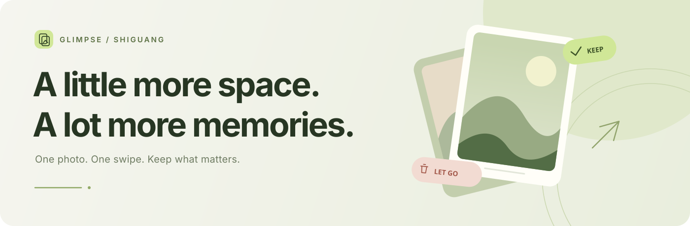
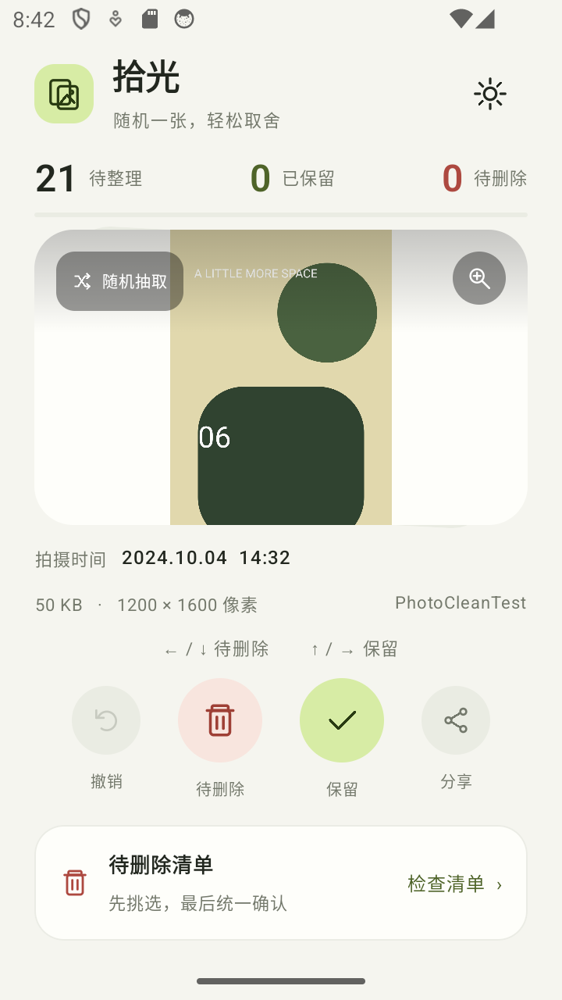
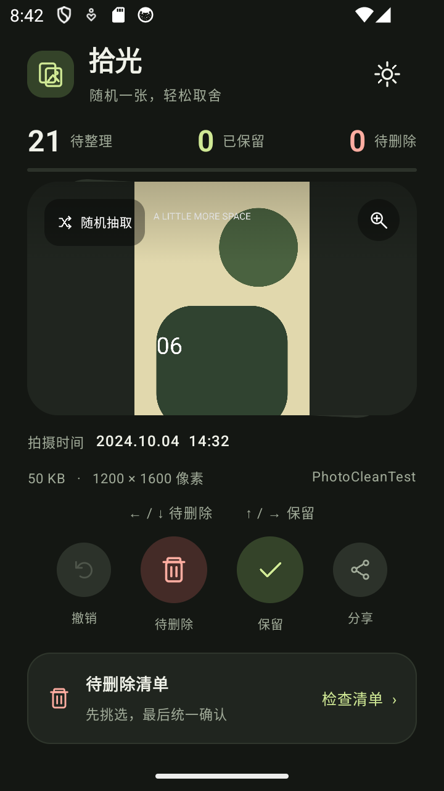
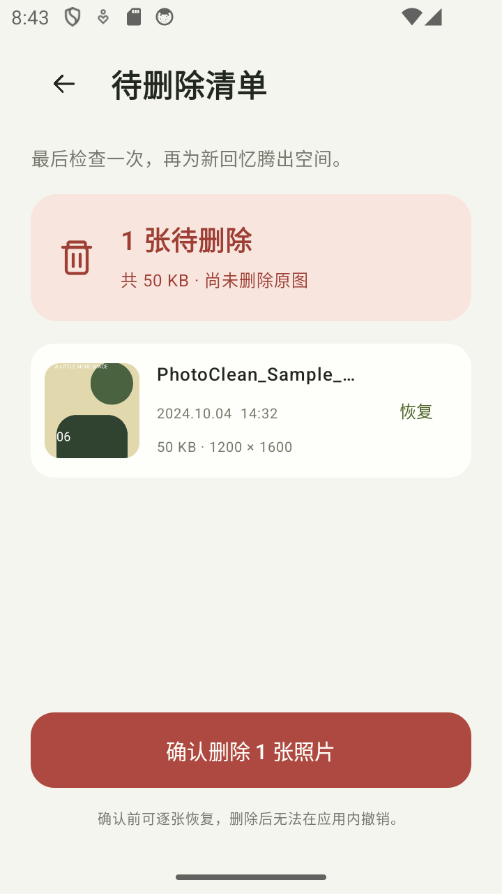
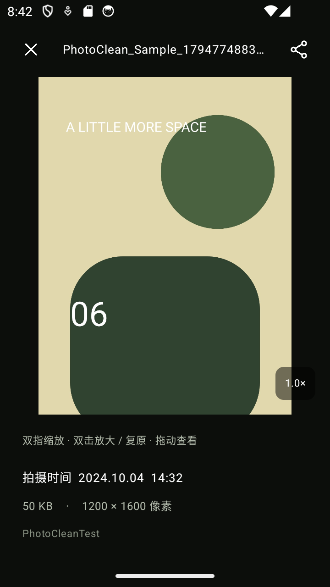
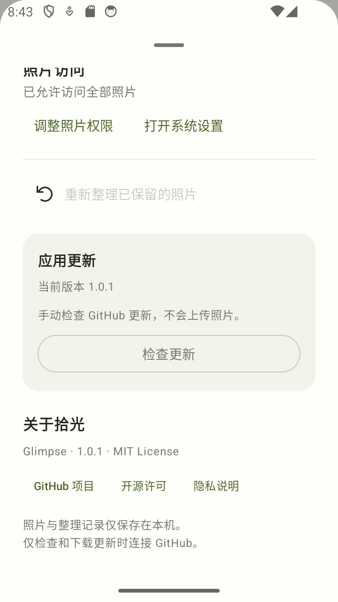

<p align="center">
  <picture>
    <source media="(prefers-color-scheme: dark)" srcset="docs/assets/banner-dark.svg">
    
  </picture>
</p>

<h1 align="center">拾光 · Glimpse</h1>

<p align="center"><strong>给相册，留点空间。</strong></p>
<p align="center">从一张随机照片开始，留下喜欢的，告别多余的。</p>

<p align="center">
  
  
  <a href="LICENSE"></a>
  <a href="https://github.com/DaliBerr/glimpse-android/releases/latest"></a>
</p>

<p align="center">
  <a href="https://github.com/DaliBerr/glimpse-android/releases/latest"><strong>下载安装</strong></a> ·
  <a href="#界面预览">界面预览</a> ·
  <a href="#开始整理">使用方法</a> ·
  <a href="#本地开发">本地开发</a> ·
  <a href="https://github.com/DaliBerr/glimpse-android/issues">问题反馈</a>
</p>

---

拾光是一款轻量的安卓原生相册整理工具。它把相册里尚未处理的照片随机交到你面前，让每次整理只需要做一个小决定：保留，或加入待删除清单。

照片在本机读取与处理，整理进度会保存下来。可以随时放大看细节、分享原图，也可以撤销刚才的选择，慢慢整理。

## 界面预览

<table>
  <tr>
    <th width="33%">浅色 · 留一点空白</th>
    <th width="33%">深色 · 安静地翻看</th>
    <th width="33%">清单 · 最后再决定</th>
  </tr>
  <tr>
    <td></td>
    <td></td>
    <td></td>
  </tr>
</table>

<details>
<summary>展开查看照片详情与设置</summary>
<br>
<table>
  <tr><th width="50%">放大查看</th><th width="50%">外观、更新与关于</th></tr>
  <tr>
    <td align="center"></td>
    <td align="center"></td>
  </tr>
</table>
</details>

<sub>截图来自 Android 14 模拟器，画面使用程序生成的测试图片。</sub>

## 一次滑动，一个决定

| 操作 | 会发生什么 |
| :--- | :--- |
| **左滑 / 下滑** | 加入待删除清单，原图仍留在相册中 |
| **右滑 / 上滑** | 保留这张，继续下一张随机照片 |
| **撤销** | 逐步撤销先前的选择，让那张照片回到面前 |
| **轻触照片** | 进入详情，双指缩放、拖动或双击放大 / 复原 |
| **分享** | 打开安卓系统分享面板，分享原始照片 |
| **检查清单** | 逐张恢复，或检查后统一申请系统删除 |

> **删除前还有一次选择。** 加入清单不会删除原图。正式删除需要应用内确认和系统授权；永久删除完成后，无法在拾光中撤销。

## 小而完整

- **随机，不重复**：从可访问的全部相册抽取；已保留、已加入清单的照片不再出现。关闭应用后可继续整理。
- **信息就在眼前**：拍摄时间、文件大小、像素尺寸和相册名称；时间索引缺失时补读原图 EXIF。
- **看清楚再决定**：独立的照片详情与缩放手势，查看细节时不会触发整理动作。
- **有反馈的操作**：滑动方向提示、触觉反馈、回弹、照片切换、进度和清单动画。
- **按习惯选择外观**：浅色、深色或跟随系统。
- **更新入口内置**：在设置中手动检查 GitHub 正式版本，下载并校验安装包，再交给安卓系统确认安装。
- **照片留在本机**：没有账号、广告或统计组件；更新请求不携带照片和整理记录。

## 开始整理

1. 前往 [Releases](https://github.com/DaliBerr/glimpse-android/releases/latest)，下载 `Glimpse-版本号.apk`，在 **Android 10 或更高版本**上安装。
2. 打开拾光，按系统提示授权照片访问。Android 14 及以上可以只授权选定照片。
3. 左 / 下滑加入待删除，右 / 上滑保留；底部按钮也可以完成同样的操作。
4. 整理一会儿后打开待删除清单，检查照片，再决定是否正式删除。

日后可通过 **右上角设置 → 应用更新 → 检查更新** 获取新版本。首次在应用内安装更新时，安卓系统会要求授权安装来源。

## 照片隐私

照片通过系统 MediaStore 读取，选择记录保存在应用私有 SQLite 数据库中，外观设置保存在本机。应用不上传照片、照片信息或整理记录。

只有主动检查或下载更新时，应用才连接 GitHub；GitHub 会像处理普通网络请求一样接收到 IP 地址等请求信息。分享则由系统交给你选择的应用。

具体权限与数据处理方式见 [隐私说明](docs/PRIVACY.md)。

## 本地开发

准备 **JDK 21**、**Android SDK 36** 和 Android Studio。项目自带 Gradle Wrapper。

```bash
git clone https://github.com/DaliBerr/glimpse-android.git
cd glimpse-android
```

用 Android Studio 打开项目并等待同步，然后运行 `app`。也可以在 Windows 下直接构建：

```powershell
.\gradlew.bat assembleDebug
```

macOS / Linux 对应命令为 `./gradlew assembleDebug`。安装包位于 `app/build/outputs/apk/debug/app-debug.apk`。

| 组成 | 技术 |
| :--- | :--- |
| 界面 | Kotlin · Jetpack Compose · Material 3 |
| 照片访问 | Android MediaStore · EXIF |
| 状态与任务 | ViewModel · StateFlow · Coroutines |
| 本地记录 | SQLite · SharedPreferences |
| 更新 | GitHub Releases · HTTPS · SHA-256 · APK 签名校验 |

SDK 路径、签名、Release 构建、项目结构和排障详见 [开发指南](docs/DEVELOPMENT.md)。

## 验证与贡献

```powershell
.\gradlew.bat testDebugUnitTest lintDebug
```

测试覆盖滑动方向、去重、撤销、元数据、更新来源和安装包身份校验。已有 Android 14 模拟器操作检查；不同品牌手机和系统版本仍欢迎补充验证，具体记录见 [测试说明](docs/TESTING.md)。

欢迎通过 [Issues](https://github.com/DaliBerr/glimpse-android/issues) 反馈问题，或提交小而清楚的 Pull Request。请用测试图片复现问题，避免在公开反馈中附上私人照片。

<details>
<summary>值得了解的当前范围</summary>

- 当前整理对象为手机可访问的图片，不包含视频，也不会遍历仅保存在云端的相册。
- 没有拍摄时间的图片会明确显示“添加时间”。
- 放大预览会按设备内存限制解码尺寸；分享仍使用原始文件。
- Debug 版本使用独立的应用 ID，更新通过开发工具完成；内置更新面向正式 APK。
- 系统永久删除后的原图恢复，超出应用内撤销的范围。

</details>

## 开源许可

以 [MIT License](LICENSE) 开源，允许使用、修改和商业使用，请保留版权及许可声明。第三方依赖遵循各自的许可证。

更新流程参考 [Vibe Halo](https://github.com/DaliBerr/Vibe-Halo)，在拾光中使用 Android 标准 API 实现。

---

<p align="center">一张一张，留下想留下的。</p>
